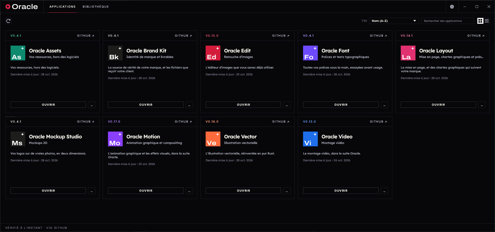

<p align="center">
  <picture>
    <source media="(prefers-color-scheme: dark)" srcset="docs/brand/oracle-logo-white.svg">
    
  </picture>
</p>

<h1 align="center">Oracle Suite</h1>

<p align="center">
  <b>One place to install, update and open every app in the Oracle Suite, rebuilt in pure Rust.</b><br>
  Oracle Edit, Oracle Vector, Oracle Brand Kit, Oracle Mockup Studio and Oracle Layout,<br>
  plus the shared asset library: the right build for your computer, kept up to date.
</p>

<p align="center">
  
  
  
  
  <br>
</p>

<p align="center">
  <a href="https://github.com/Marvingxx/oracle-suite/releases/latest"><b>Download Oracle Suite</b></a> ·
  <a href="https://github.com/Marvingxx/oracle-suite">Oracle Suite</a>
</p>


<p align="center">
  
</p>
<p align="center">
  <sub>Switch between the grid and a sortable table.</sub>
</p>

## What it does

The Oracle apps each ship their own builds for every platform. Oracle Suite saves you from
hunting through a dozen release pages: it lists every app in the suite, shows which ones you have
and which version, installs the right build for your operating system and processor, and tells
you when an update is out. It is a small native app that can sit in your menu bar or system tray.

## Features

<table>
  <tr>
    <td width="33%" valign="top">
      <h3>📦 Install in one click</h3>
      Picks the right download for your OS and CPU (DMG, MSI, AppImage, .deb, .rpm and more), checks it against the release's SHA-256 checksums and installs it.
    </td>
    <td width="33%" valign="top">
      <h3>🔄 Stay up to date</h3>
      Checks each app's GitHub releases and updates the ones you have. A notification tells you when there's something new.
    </td>
    <td width="33%" valign="top">
      <h3>🧭 Always at hand</h3>
      Opens any Oracle app from one window, or from the tray and menu-bar icon. Native egui, no Electron, no web view.
    </td>
  </tr>
</table>

The web version shows the same catalog in the browser, with the latest download for each app.

The desktop launcher also opens existing local applications such as Pratique, using a
[local registration](docs/local-apps.md). These entries reuse their installed executable and data.

## Interface languages

The interface is in English, Brazilian Portuguese (Português (Brasil)), Czech (Čeština), French
(Français), German (Deutsch), Hungarian (Magyar), Japanese (日本語), Polish (Polski), Russian
(Русский), Simplified Chinese (简体中文) or Spanish (Español). **Auto**, the default, follows the
system or browser language; **Settings → Language** picks one and switches at once, and the choice
is kept between runs. Czech locales (`cs-CZ`, `cs_CZ.UTF-8`…) select Czech, German ones (`de-DE`,
`de-AT`, `de-CH`, `de_DE.UTF-8`…) German, French ones (`fr-FR`, `fr-CA`…) French, Hungarian ones
(`hu`, `hu-HU`, `hu_HU.UTF-8`…) Hungarian, Japanese ones (`ja`, `ja-JP`, `ja_JP.UTF-8`…) Japanese,
Polish ones (`pl`, `pl-PL`, `pl_PL.UTF-8`) Polish, Spanish ones (`es-ES`, `es-MX`, `es-419`…)
Spanish, and Portuguese ones (`pt-BR`, and `pt-PT` too, for now) Brazilian Portuguese. Simplified
Chinese locales (`zh-CN`, `zh-SG`, `zh-Hans`, and POSIX forms such as `zh_CN.UTF-8`) select
Chinese; Traditional Chinese ones don't. To try a language without changing the setting, start the
desktop app with `ORACLE_SUITE_LOCALE=pt-BR`, or add `?lang=ru` to the web address.

The CJK languages are drawn with the system's own CJK font (Hiragino Sans or PingFang on macOS,
Yu Gothic, Meiryo or Microsoft YaHei on Windows, Noto Sans CJK, IPA, Takao or WenQuanYi on Linux and
FreeBSD). Where the system has no font for one, and in the web version, the interface stays in
English and Settings says why. Product names and release notes stay as published; text without a
translation falls back to English.

## Where apps are installed

Oracle Suite installs each app where your system normally keeps applications, using the
app's official release package, so an app installed by the launcher is the same as one you
installed by hand (and the launcher finds apps you installed yourself):

| System | Where | How |
|---|---|---|
| macOS | `/Applications/<App>.app` | Copied from the signed, notarized release DMG |
| Windows | `C:\Program Files\<App>` | The release MSI, through Windows Installer (with Start menu entry and Apps & features entry) |
| Linux | `/usr/bin`, `/usr/share/applications` | The release `.deb` (apt) or `.rpm` (dnf, zypper), with your system's password prompt. Without those, a Flatpak, or an AppImage in `~/Applications` |
| Linux, inside the launcher's Flatpak, with no Flatpak on the host | `~/.var/app/app.oracle.oracle-suite/data/oracle-suite/apps/<app>` | The release tarball, unpacked into the launcher's own folder and run inside the same sandbox, with its settings in a `home/` folder beside it. Nothing is installed on the host, and each app's configuration stays in the sandbox |
| FreeBSD | `/usr/local` | The release tree, with a password prompt (polkit); `~/.local` when polkit isn't installed |

Oracle Suite keeps itself current too: when a new version is out, **Update and restart**
downloads it, verifies it, puts it where this copy is installed (the `.app`, the Windows Installer
package or portable folder, the AppImage, or the `.deb`/`.rpm`) and reopens it.

Updates use the same format an app was installed with. Every download is checked against the
release's published SHA-256 before it is installed, and a running app is never replaced.

The launcher writes its log to `logs/oracle-suite.log` in its data folder
(`~/.local/share/oracle-suite` on Linux, `~/Library/Application Support/Oracle Suite`
on macOS, `%LOCALAPPDATA%\Oracle Suite` on Windows, `OracleSuiteData` beside the
portable zip's executable) and keeps the previous two runs as `oracle-suite.1.log` and
`oracle-suite.2.log`. `RUST_LOG` changes what it records (`debug`, `info,zbus=warn`, …).

## Downloads

Download the build for your computer from the [latest release](https://github.com/storytold/craft-launcher/releases/latest), or browse [all releases](https://github.com/storytold/craft-launcher/releases). Every release has a `SHA256SUMS.txt` to check the files against. `<ver>` is the version number, for example `0.1.0`.

**Windows** (10 and 11)

| File | What it is |
|---|---|
| `oracle-suite-<ver>-windows-x64.msi` | Installer for most PCs (Intel and AMD, 64-bit). Installs for the current user, no admin rights needed |
| `oracle-suite-<ver>-windows-arm64.msi` | Installer for Windows on Arm (Snapdragon and other Arm PCs) |
| `oracle-suite-<ver>-windows-x86.msi` | Installer for 32-bit Windows |
| `oracle-suite-<ver>-windows-{x64,arm64,x86}-portable.zip` | No install: unzip and run `oracle-suite.exe`. Keeps its settings in the folder |

**macOS** (11 Big Sur or later)

| File | What it is |
|---|---|
| `oracle-suite-<ver>-macos-universal.dmg` | Universal app for Apple silicon and Intel Macs, signed and notarized. Drag Oracle Suite to Applications |

**Linux** (x86_64 and aarch64; glibc 2.35 or newer, e.g. Ubuntu 22.04+, Debian 12+, Fedora 36+)

| File | What it is |
|---|---|
| `oracle-suite-<ver>-linux-{x86_64,aarch64}.AppImage` | Runs on almost any distro without installing; `chmod +x` and run. The `.AppImage.zsync` beside it lets AppImageUpdate fetch only what changed |
| `oracle-suite-<ver>-linux-{x86_64,aarch64}.deb` | Debian, Ubuntu, Mint, Pop!_OS: `sudo apt install ./oracle-suite-…deb` |
| `oracle-suite-<ver>-linux-{x86_64,aarch64}.rpm` | Fedora, openSUSE, RHEL: `sudo dnf install ./oracle-suite-…rpm` |
| `oracle-suite-<ver>-linux-{x86_64,aarch64}.flatpak` | Flatpak bundle: `flatpak install --user oracle-suite-…flatpak`. Inside the sandbox the launcher installs apps as Flatpaks on the host through `flatpak-spawn --host`; where the host has no Flatpak it falls back to each app's release tarball, unpacked and run inside the sandbox with the app's settings kept in it. Either way it can only reach the host as far as that permission allows; the AppImage, .deb and .rpm builds are the recommended way to run the launcher on Linux |
| `oracle-suite-<ver>-linux-{x86_64,aarch64}.tar.gz` | Plain tree (`bin/`, `share/`) for everyone else and for scripts |

RISC-V (riscv64): `oracle-suite-<ver>-linux-riscv64.{deb,rpm,tar.gz}`, built against Ubuntu 24.04 (needs glibc 2.39+).

The tray icon uses the StatusNotifierItem standard: KDE, Xfce, Cinnamon and most other desktops show it; on GNOME install the AppIndicator extension.

**FreeBSD** (14, x86_64)

| File | What it is |
|---|---|
| `oracle-suite-<ver>-freebsd-x86_64.tar.gz` | A tree laid out like `/usr/local` |

```sh
pkg install libxkbcommon wayland libX11 libXcursor libXrandr libXi libxcb mesa-libs vulkan-loader fontconfig freetype2
tar -xzf oracle-suite-<ver>-freebsd-x86_64.tar.gz --strip-components 1 -C /usr/local
oracle-suite
```

**Web (WebAssembly)**

| File | What it is |
|---|---|
| `oracle-suite-web-<ver>.zip` | The catalog as a static site you can host anywhere; see [`packaging/web/README.md`](packaging/web/README.md) |

## Build from source

You need a recent stable Rust (1.90 or newer). On Linux, install the windowing headers first
(Debian/Ubuntu: `sudo apt install libxkbcommon-dev libwayland-dev libx11-dev libxrandr-dev libxi-dev libgl1-mesa-dev`).

```sh
git clone https://github.com/storytold/craft-launcher
cd craft-launcher
cargo run --release -p oracle-suite   # the desktop app
cargo xtask ci                             # fmt, clippy, tests and the wasm check
```

The web version builds with [trunk](https://trunk-rs.github.io/trunk/):

```sh
rustup target add wasm32-unknown-unknown
cd apps/oracle-suite-web && trunk serve
```

### Nix (experimental)

`flake.nix` gives a dev shell (`nix develop`, then the cargo commands above) and a package:

```sh
nix run github:storytold/craft-launcher
```

On NixOS this uses the system's graphics drivers. On other distros, a Nix-built program can't load
the host's GPU drivers, so the window may fail to open. Run it through
[nixGL](https://github.com/nix-community/nixGL) instead (NVIDIA needs nixGL's matching NVIDIA
variant), or use the AppImage, `.deb` or `.rpm` release:

```sh
nix run --impure github:nix-community/nixGL -- nix run github:storytold/craft-launcher
```

### Installing your own builds

To install and update the Oracle apps from checkouts on your machine instead of GitHub, clone them
next to this repo (`../photocraft`, `../wordcraft`, …) and run:

```sh
cargo xtask local sync      # git pull every app, build and package each new version into ../local-mirror
cargo xtask local serve     # serve the builds and a release feed on http://127.0.0.1:8787/
ORACLE_SUITE_DOWNLOAD_BASE=http://127.0.0.1:8787/ cargo run --release -p oracle-suite --features local-mirror
```

Run `sync` again whenever you want updates, or let the server do it: `cargo xtask local serve
--sync-every 1h` pulls and builds on that interval while it serves. An app is rebuilt when its
checkout's version isn't in the mirror yet (`--rebuild` forces it), and the launcher's next check
picks it up. Add `--every-commit` to build every new commit instead, as a dev version between
releases (`0.4.0` builds as `0.4.1-dev.<commit time>`), which the launcher offers as an update. While
`ORACLE_SUITE_DOWNLOAD_BASE` is set (loopback addresses only), the launcher asks only the
mirror, never GitHub. Only builds with the `local-mirror` feature read it; releases never have it. `cargo xtask local help` lists the options (`--only`, `--no-pull`, `--arch`, …).

New contributors and AI agents: start with [`AGENTS.md`](AGENTS.md). Release packaging lives in
[`packaging/`](packaging/) and [`.github/workflows/release.yml`](.github/workflows/release.yml).

> [!IMPORTANT]
> **Status:** Oracle Suite is new and in early alpha. Expect rough edges, and please file
> issues (include your OS, which app you were installing and the launcher's log file).

## The Oracle suite

Oracle Suite is part of **Oracle**, a personal creative suite, free and local:

| App | What it's for | Code |
|---|---|---|
| **Oracle Suite** | Launcher: installs, updates and opens the apps; the shared asset library | [oracle-suite](https://github.com/Marvingxx/oracle-suite) |
| **Oracle Edit** | Image editing | [oracle-edit](https://github.com/Marvingxx/oracle-edit) |
| **Oracle Vector** | Vector illustration | [oracle-vector](https://github.com/Marvingxx/oracle-vector) |
| **Oracle Brand Kit** · **Oracle Mockup Studio** | Brand identities and client deliveries · 2D mockups | [oracle-brand](https://github.com/Marvingxx/oracle-brand) |
| **Oracle Layout** | Brand guidelines and page layout | [oracle-layout](https://github.com/Marvingxx/oracle-guide) |


## Thanks

Before Oracle Suite, the community built launchers for the Craft apps it comes from, and Oracle Suite
learned a lot from them. Thank you to their authors:

| Project | Author | What we learned from it |
|---|---|---|
| [ArtCraft Suite Updater](https://github.com/Lyraedan/ArtCraft-Suit-Updater) | [@Lyraedan](https://github.com/Lyraedan) | Noticing apps installed or removed outside the updater with a quiet background re-scan, detecting Arch and AUR installs through pacman, and a platform picker that lists the downloads for every OS |
| [craftcenter](https://github.com/avokadosauce/craftcenter) | [@avokadosauce](https://github.com/avokadosauce) | Finding the latest release without spending API quota (the `releases/latest` redirect plus `SHA256SUMS.txt`), and verifying every file |
| [CRAFTSPACE](https://github.com/emircesur/CRAFTSPACE) | [@emircesur](https://github.com/emircesur) | Adopting apps that were already installed, falling back gracefully when GitHub rate-limits, background update notifications |
| [GetCraft](https://github.com/mbirnbach/getcraft) | [@mbirnbach](https://github.com/mbirnbach) | Picking the right download for each OS and CPU, recognising Windows Installer and macOS installs, a native Rust/egui launcher |
| [CraftHub](https://github.com/CraftHubLauncher/CraftHub) | [CraftHubLauncher](https://github.com/CraftHubLauncher) | Strict checks on where downloads come from, clear rate-limit messages, never replacing an app while it runs |
| [artcraft-suite](https://github.com/erikerikerik/artcraft-suite) | [@erikerikerik](https://github.com/erikerikerik) | ETag-cached release checks and installs that recover cleanly from interruptions |
| [Oracle apps Launcher & Installer](https://github.com/ZifuM/Craft-apps-launcher-installer) | [@ZifuM](https://github.com/ZifuM) | Release-page fallbacks and starting AppImage apps with a clean environment |
| [Oracle Suite](https://github.com/EricVogt93/oracle-suite) | [@EricVogt93](https://github.com/EricVogt93) | Desktop integration for AppImages and a careful self-update design |
| [LandingCraft](https://github.com/rallegretti/LandingCraft) | [@rallegretti](https://github.com/rallegretti) | Working with the Windows Installer directly and offering stable releases only |
| [Oracle apps Manager](https://github.com/CryptoKey98/craft-apps-manager) | [@CryptoKey98](https://github.com/CryptoKey98) | Scheduled background update checks and per-app launch options |
| [ArtCraft Hub Launcher](https://github.com/tinyplayerss/artcraft-hub-launcher) | [@tinyplayerss](https://github.com/tinyplayerss) | A friendly, one-window hub for the whole suite |
| [CraftHub](https://github.com/MegaTheLEGEND/CraftHub) | [@MegaTheLEGEND](https://github.com/MegaTheLEGEND) | Serving the apps' web builds from a self-hosted launcher |

## Sources

Oracle Suite is built on [craft-launcher](https://github.com/storytold/craft-launcher) by storytold (MIT OR
Apache-2.0), taken on 22 October 2026 and developed separately since; its code, rewritten or not, keeps
that licence and the original notices (`NOTICE`, `LICENSE-*`). Every other source (fonts, icons,
libraries, images) is listed with its author and licence in the attribution file.

## License and credits

Oracle Suite is dual-licensed under [MIT](LICENSE-MIT) or [Apache-2.0](LICENSE-APACHE), at your option.
Required notices are in [NOTICE](NOTICE).

Bundled fonts, icons, images and other assets keep their own open licenses; each one is listed
with its author, source and license in [ATTRIBUTION.md](ATTRIBUTION.md).

The app icons of the Oracle apps (`assets/app-icons/`) are each app's own icon, copied unmodified
from its repository and licensed like that app (MIT OR Apache-2.0).

The Oracle name and logo in [`docs/brand/`](docs/brand/) are the project's brand marks and are not
covered by this license (see [`docs/brand/LICENSE-brand.txt`](docs/brand/LICENSE-brand.txt)).

